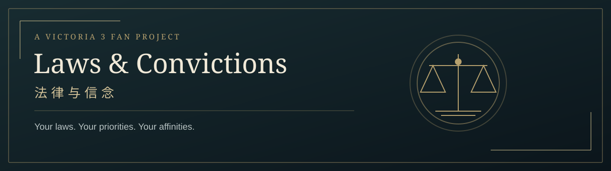

<p align="center"></p>

<p align="center">
  <strong>A Victoria 3 law-preference assessment · 维多利亚 3 法律倾向测评</strong><br>
  Choose the laws of your ideal society. Explore the ideologies and interest groups closest to your choices.
</p>

<p align="center">
  <a href="https://victoria3-laws-and-convictions.mkp872087265.chatgpt.site/">▶ 在线试玩 / Live demo</a>
  · <a href="#中文">中文介绍</a>
  · <a href="#english">English</a>
</p>

<p align="center">React 19 · TypeScript · Vinext / Vite · 简体中文 / English · Browser-side scoring</p>

## 中文

**把你支持的法律拼成理想社会，看看它与哪些游戏意识形态、利益集团接近。**

这是一个以《维多利亚 3》为背景的独立同人项目。测评比较的是游戏中的法律立场，不分析具体历史人物，也不是现实政治身份诊断。匹配分表示选择的一致程度，并非身份概率。

### 可以做什么

| 功能 | 体验 |
| --- | --- |
| 快速答题 | 在法律旁直接点「支持 / 反对」，不确定就跳过 |
| 详细答题 | 为每条法律选择顺位，支持并列、部分排序和整类跳过 |
| 多个匹配结果 | 意识形态可以同时匹配多个；八大利益集团独立计算 |
| 有依据的解释 | 展示实际参与计分的一致点、分歧点及覆盖类别数 |
| 双语界面 | 简体中文 / English；原版描述在前，白话解释在后 |
| 游戏风格 | 法律面板与 IG 详情面板，电脑优先，兼容手机 |

所有法律类别初始收起。某类法律首次全部填写后自动收起一次；再次打开后，由你手动收起。返回修改时保留答案，刷新页面会清空。评分在浏览器中完成，不需要账号或测评数据库。

### 如何计算

- **详细模式：** 在同一类别内比较两条已评价法律的顺序。一致计 1、相反计 0、一方并列计 0.5、双方并列计 1。先求类别内平均，再对类别等权平均。
- **快速模式：** 将支持或反对与候选立场的正负方向比较。一致计 1、相反计 0、中立计 0.5；每类内取平均，再对类别等权平均。
- 未评价的法律不扣分。候选没有立场的类别不参与其计分；有立场类别内未单列的法律按中立处理。
- IG 先在类别内平均其基础意识形态的有效得分，再汇总类别；不加入领袖、国家、事件或存档影响。
- 主要意识形态需达到 70 分且距最高分不超过 10 分，数量不限。无有效依据时不出结论，少于三个有效类别时标作初步结果。
- **女权主义者（Feminist）列为「单项倾向 · 论外」**，单独保留得分和依据，不挤占综合意识形态排名。这是本测评的产品选择，并未删除原始立场或改变 IG 计算。

### 数据版本与范围

当前演示使用 **1.14 公测分支 `1.14-openbeta`，Steam build `25207758`，更新标记 2026-09-08** 的历史快照。它不是 1.13.11 正式版，也不代表当前最新版。

该快照包含 **24 类通用法律、110 条法律、46 个人物意识形态定义和 8 大 IG**；其中 Feminist 单列，其余有有效依据的候选参与综合排名。国家专属法律变体不纳入答题，不考虑科技、推行难度和游戏内前置条件。「人物意识形态」指游戏定义的类型，而非某个具体人物。

**仓库只分发项目代码、白话说明和提取工具。** 原版图标、纹理、完整游戏描述及提取快照不随代码分发。完整体验可直接使用在线试玩；本地运行需从你自己的对应版本游戏安装中生成数据。

### 本地运行

需要 **Node.js 24、Python 3 和 Pillow**。在项目目录中运行：

```sh
npm ci
python -m pip install Pillow
python scripts/extract-game.py --game-path "PATH_TO_STEAM/steamapps/common/Victoria 3/game"
npm run local
```

然后打开 <http://localhost:5173/>。`--game-path` 应指向 `game` 文件夹；相应 Steam 库的 `steamapps/appmanifest_529340.acf` 也必须存在。提取器会检查 `1.14-openbeta` 分支，记录实际 build ID 和源文件哈希，不会把其他版本冒充此快照。其他 build 未经本项目验证，可能需要同步更新解释和测试。

未生成数据时可检查代码、运行纯逻辑测试和构建，但无法开始完整测评；界面会提示先提取数据。

```sh
npm test
npm run typecheck
npm run build
```

测试覆盖排序解析、并列、跳过、非法输入、类别等权、IG 同分、证据生成与面板收起。干净克隆不含游戏数据时，10 项数据集成测试明确跳过；生成完整快照后会参与运行，包括源文件哈希和立场逐项核对。

### 代码导航

| 文件 | 职责 |
| --- | --- |
| [`app/page.tsx`](app/page.tsx) | 封面、语言与模式选择、法律答题 |
| [`components/assessment-results.tsx`](components/assessment-results.tsx) | 多意识形态、IG 排名与证据 |
| [`lib/ranking.ts`](lib/ranking.ts) | 排序解析与并列组 |
| [`lib/scoring.ts`](lib/scoring.ts) | 两种模式评分、IG 汇总与结果选择 |
| [`lib/law-panel.ts`](lib/law-panel.ts) | 首次完成后的自动收起状态 |
| [`scripts/extract-game.py`](scripts/extract-game.py) | 本机游戏数据提取与来源记录 |
| [`tests/core.test.ts`](tests/core.test.ts) | 评分、交互状态与数据核验 |

## English

**Design your ideal society through its laws, then discover the Victoria 3 ideologies and interest groups closest to your preferences.**

Laws & Convictions is an independent fan project with a bilingual interface, a game-inspired layout, and explainable scoring. It compares law preferences against ideology definitions, not individual historical characters or real-world political identities.

### Two ways to answer

- **Quick:** click Support or Oppose beside a law. Leave uncertain questions unanswered.
- **Detailed:** choose preference ranks, including ties and partial rankings. Entire categories may be skipped.

Results can include several ideologies. The eight interest groups are scored independently using their base ideologies. Each match shows its evidence coverage and the specific agreements and disagreements that contributed to the score. Answers stay in memory when returning to edit; refreshing clears them.

### Scoring and limitations

Detailed mode compares pairs of ranked laws: matching order scores 1, opposite order 0, one-sided ties 0.5, and mutual ties 1. Quick mode compares support/opposition with the sign of a candidate's stance: agreement scores 1, disagreement 0, and neutrality 0.5. Both modes average within each category before weighting categories equally.

Unanswered laws incur no penalty. Categories with no candidate stance are excluded; unlisted laws in a defined category are neutral. IG scores average relevant base ideologies within each category, then average across categories. No country, leader, event, or save-game modifiers are used.

Primary ideologies must score at least 70 and be within 10 points of the best ranked result. Fewer than three effective categories yield preliminary results. **Feminist is shown separately as a single-issue affinity**, retaining its score and evidence while leaving the main ranking and IG calculation independent of that display choice. Scores measure agreement, not identity probabilities; candidates with narrow evidence coverage can score highly, so coverage matters.

### Version and local setup

The demo uses the historical **Victoria 3 1.14 open beta**, branch `1.14-openbeta`, Steam build `25207758`, update label **2026-09-08**: 24 general law categories, 110 laws, 46 character ideology definitions (one displayed separately), and eight interest groups. It is neither the 1.13.11 release nor a claim of compatibility with today's latest game.

Game textures, icons, original descriptions, and extracted snapshots are **not included** in this repository. Use the [live demo](https://victoria3-laws-and-convictions.mkp872087265.chatgpt.site/) for the complete experience. To run locally, install Node.js 24, Python 3 and Pillow, then run the commands in the local setup section above with the `game` directory from your own matching Steam installation. The extractor checks the branch and records the actual build ID and source hashes. Other builds are unverified.

`npm test`, `npm run typecheck`, and `npm run build` work without a game snapshot. Ten dataset integration tests are explicitly skipped when no snapshot exists; after extraction they verify source hashes, law definitions, translations, icons, and scores. The project uses React, TypeScript, Vinext/Vite and the Sites starter build tooling. Assessment scoring runs in the browser and needs no account or database.

## Attribution

Victoria 3 and its game content belong to their respective rights holders. This is an unofficial fan project and is not affiliated with or endorsed by Paradox Interactive. The repository does not grant rights to redistribute game files. Third-party dependencies and included build/vendor components retain their respective licenses; bundled notices are preserved. The interface was built with the assistance of Codex.
